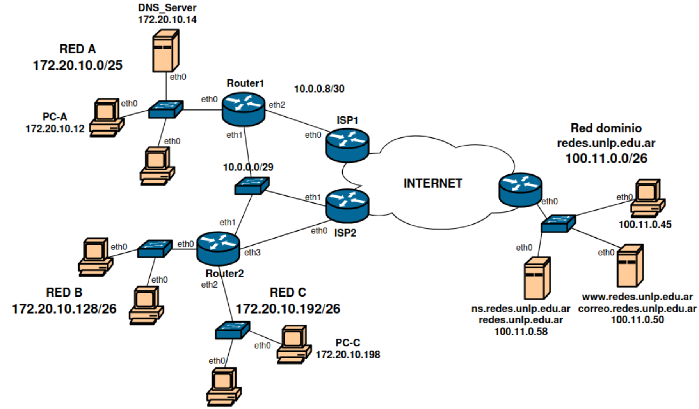

# Capa de enlace

## ARP (Address Resolution Protocol)

---

# ¿Qué hace la capa de enlace?

- Entramado (framing):
    - encapsulado del datagrama en la trama (PDU), agregando encabezado (*header*) y cola (*trailer*)
- Acceso al enlace:
    - acceso al canal si es un medio compartido (*Medium Access Control*)
    - direcciones MAC utilizadas en los encabezados de las tramas para identificar el origen y destino
- Entrega confiable:
    - entre nodos adyacentes
    - rara vez se usa en enlaces de pocos errores (fibra óptica, pares enlazados, etc.)
- Control de flujo
    - acuerdo entre los nodos emisor y receptor (aquí, adyacentes)
    - buffers y capacidad de procesamiento

---

# ¿Qué hace la capa de enlace?

- Detección de errores
    - errores causados por atenuación de la señal, por ruido, etc.
    - el receptor detecta presencia de errores
        - señaliza al emisor para una retransmisión o descarta la trama
- Corrección de errores (FEC)
    - el receptor identifica y corrige el o los erroes en bit/s sin necesidad de retransmisión
- half-duplex y full-duplex:
    - con half-duplex, los nodos en los extremos del enlace pueden transmitir pero no al mismo tiempo


```text
Paquete IP  →  encapsulado en una trama Ethernet  →  enviado por el enlace
```

---

# ¿Qué es Ethernet?


Ethernet no es una sola tecnología física, sino una familia de estándares bajo el IEEE 802.3.

Tecnología LAN cableada dominante.


<table style="width: 100%; table-layout: fixed; border-collapse: collapse; text-align: center; font-size: 0.78em;">
    <colgroup>
        <col style="width: 13%;">
        <col style="width: 17%;">
        <col style="width: 17%;">
        <col style="width: 12%;">
        <col style="width: 27%;">
        <col style="width: 14%;">
    </colgroup>
    <thead>
        <tr>
            <th style="border: 1px solid #555; background: #f3e66b; padding: 0.6em 0.3em;">Preámbulo + SFD<br>(8 bytes)</th>
            <th style="border: 1px solid #555; background: #70c7d2; padding: 0.6em 0.3em;">Dirección destino<br>(6 bytes)</th>
            <th style="border: 1px solid #555; background: #70c7d2; padding: 0.6em 0.3em;">Dirección origen<br>(6 bytes)</th>
            <th style="border: 1px solid #555; background: #bd91cb; padding: 0.6em 0.3em;">Tipo<br>(2 bytes)</th>
            <th style="border: 1px solid #555; background: #79bf68; padding: 0.6em 0.3em;">Datos<br>(46–1500 bytes)</th>
            <th style="border: 1px solid #555; background: #e66c64; padding: 0.6em 0.3em;">CRC / FCS<br>(4 bytes)</th>
        </tr>
    </thead>
</table>

<br>

#### Servicio no confiable, no orientado a conexión
* no orientado a conexión: no hay *handshaking* entre NICs emisor y receptor.
* no confiable: la NIC que recibe no envía ACKs o NAKs a la NIC emisora.
* protocolo MAC (*Media Access Control*) de Ethernet: CSMA/CD


---

# Direcciones MAC

Una MAC Ethernet tiene **48 bits** y suele escribirse como seis pares hexadecimales.

```text
02:1A:2B:3C:4D:5E
```

- **Broadcast Ethernet:** `FF:FF:FF:FF:FF:FF`, destino a todas las interfaces de la LAN.

```bash
❯ ip -br link
lo               UNKNOWN        00:00:00:00:00:00 <LOOPBACK,UP,LOWER_UP> 
enp0s31f6        DOWN           b2:6c:83:14:a7:50 <NO-CARRIER,BROADCAST,MULTICAST,UP> 
wlan0            UP             5e:2f:91:c8:43:ab <BROADCAST,MULTICAST,UP,LOWER_UP> 
docker0          DOWN           3a:91:c4:2d:7f:b8 <NO-CARRIER,BROADCAST,MULTICAST,UP> 
```

```bash
❯ ip link show docker0
4: docker0: <NO-CARRIER,BROADCAST,MULTICAST,UP> mtu 1500 qdisc noqueue state DOWN mode DEFAULT group default qlen 0
    link/ether 3a:91:c4:2d:7f:b8 brd ff:ff:ff:ff:ff:ff
```

--- 

# ARP

¿Qué es?

- protocolo de capa 2 (a veces considerado de capa 3)
- protocolo "*helper*" de IP
- mapea direcciones lógicas (IPs) a direcciones físicas o de hardware (MACs)
- trabaja conjuntamente con Ethernet (u otros protocolos multiacceso con broadcast)
- trabaja de forma dinámica, autoaprendizaje, sin configuración
- puede configurarse de forma estática
- RFC-826


---

# Cómo viaja ARP en Ethernet

```text
TRAMA ETHERNET
┌────────────── Cabecera Ethernet (14 bytes) ──────────────────┐┌── Mensaje ARP (28 bytes) ───┐
│ MAC destino (6) │ MAC origen (6) │ EtherType (2)             ││ Campos ARP                  │
└──────────────────────────────────────────────────────────────┘└─────────────────────────────┘
```

| Campo Ethernet | Valor en el request |
| --- | --- |
| MAC destino | `FF:FF:FF:FF:FF:FF` (broadcast) |
| MAC origen | `02:00:00:00:00:0A` (PC A) |
| EtherType | `0x0806` (contenido ARP) |


---

# Veamos un ejemplo: las tablas ARP están vacías



- **PC-A** realiza una consulta DNS hacia **DNS_Server** y recibe una respuesta exitosa. Indique el ARP **Request** y ARP **Reply** que pasan por el switch de la Red A.

- **PC-C** realiza un ping ICMP hacia **PC-A**. Indique ARP **Request** y ARP **Reply** que pasan por el switch de la red Red C.


---

# El problema que resuelve ARP

La PC conoce la IP del destino, pero para armar una trama Ethernet necesita su MAC.

**ARP** (Address Resolution Protocol) pregunta qué dirección MAC corresponde a una dirección IPv4 dentro de la red local.

| **Dato** | **Valor en la topología** |
| --- | --- |
| Red A | `172.20.10.0/25` |
| IP de PC-A | `172.20.10.12` |
| IP de DNS_Server | `172.20.10.14` |
| MAC de PC-A / DNS_Server | `MAC_PC-A_eth0` |
| DNS_Server | `MAC_DNS_Server_eth0` |


---

## Caso 1: ARP Request de PC-A hacia DNS_Server

#### Paso 1: MAC destino Ethernet

<EncapsulationTable :stage="0" />

PC-A (`172.20.10.12`) consulta quién tiene la IP del DNS (`172.20.10.14`).

---

## ARP Request: completar la trama

#### Paso 2: MAC origen Ethernet

<EncapsulationTable :stage="1" />


---

## ARP Request

#### Paso 3: MAC origen ARP (`SHA`)

<EncapsulationTable :stage="2" />

`SHA` identifica al emisor del mensaje ARP.

---

## ARP Request

#### Paso 4: IP origen ARP (`SPA`)

<EncapsulationTable :stage="3" />


---
layout: center
---


---

## ARP Request

#### Paso 5: MAC destino ARP (`THA`)

<EncapsulationTable :stage="4" />

Como PC-A aún no conoce la MAC del DNS_Server, `THA` se envía en cero.

---

## ARP Request

#### Paso 6: IP objetivo ARP (`TPA`)

<EncapsulationTable :stage="5" />


---
layout: center
---


---

## ARP Request completo (de PC-A consultando por MAC de DNS_Server)

<EncapsulationTable :stage="6" />

La IP buscada es la del DNS_Server: `172.20.10.14`.


---


# ¿Qué ocurre con el request?

<div v-click>

1. El switch recibe la trama y aprende qué MAC está detrás del puerto de PC A.

</div>
<div v-click>

2. Como la MAC destino es broadcast, el switch la distribuye por todos los puertos de esa LAN, excepto el de entrada.

</div>
<div v-click>

3. Todos los hosts dentro del dominio de broadcast reciben la solicitud; DNS_Server (`172.20.10.14`) es quien debe responder.

</div>

<div v-click>

El request no atraviesa un router: ARP resuelve direcciones en el enlace local.

</div>


---

# Dominios de broadcast y de colisión

En la topología, cada red local conectada a un router es un dominio de broadcast distinto: Red A (`172.20.10.0/25`), Red B (`172.20.10.128/26`) y Red C (`172.20.10.192/26`). El router no reenvía el broadcast ARP de una red a las otras.

- En Red A, el request ARP de **PC-A** llega por el switch a **DNS_Server** y a las demás interfaces de esa LAN.
- En Red C, un request ARP de **PC-C** para conocer la MAC del **gateway** llega a los puertos del switch de Red C, no a Red A.
- En un switch, cada puerto constituye su propio dominio de colisión, es decir, dividen dominios de colisión.
- Los routers separan dominios de broadcast; los switches los extienden dentro de la misma LAN.
- Los hubs (o repetidores) extienden los dominios de colisión.


---

# 2. ARP Reply de DNS_Server a PC-A

#### Paso 1: MAC destino Ethernet

<EncapsulationTable mode="reply" :stage="0" />

DNS_Server reconoce su IP y responde a PC-A.

---

## ARP Reply: completar la trama

#### Paso 2: MAC origen Ethernet

<EncapsulationTable mode="reply" :stage="1" />


---

## ARP Reply

#### Paso 3: MAC origen ARP (`SHA`)

<EncapsulationTable mode="reply" :stage="2" />


---

## ARP Reply

#### Paso 4: IP origen ARP (`SPA`)

<EncapsulationTable mode="reply" :stage="3" />


---
layout: center
---


---

## ARP Reply

#### Paso 5: MAC destino ARP (`THA`)

<EncapsulationTable mode="reply" :stage="4" />


---

## ARP Reply

#### Paso 6: IP destino ARP (`TPA`)

<EncapsulationTable mode="reply" :stage="5" />


---
layout: center
---


---

## ARP Reply completo de DNS_Server respondiendo con su MAC

<EncapsulationTable mode="reply" :stage="6" />

En un ARP Reply, el equipo que posee la IP consultada informa su MAC al emisor, normalmente mediante un mensaje unicast.


---

# Después del reply

<div v-click>

1. PC-A guarda temporalmente la relación `172.20.10.14 → MAC_DNS_eth0` en su caché ARP.

</div>
<div v-click>

2. PC-A envía el paquete IP al DNS_Server dentro de una trama con `MAC_DNS_eth0` como destino.

</div>
<div v-click>

3. Para otros paquetes a esa IP, PC A reutiliza la caché mientras la entrada siga vigente.

</div>

```text
PC-A ── request ARP broadcast ──> Red A
PC-A <── reply ARP unicast ───── DNS_Server
PC-A ── trama con consulta DNS ─> DNS_Server
```


---

# ¿Y si el destino está en otra red? PC-A quiere llegar a PC-C

PC-A (`172.20.10.12`, Red A) quiere enviar un paquete a PC-C (`172.20.10.198`, Red C), que está en otra subred.

<div v-click>

- **PC-A** resuelve por ARP la MAC de su gateway: Router1 `eth0`. El request ARP (broadcast) queda dentro de Red A; el router **no** lo reenvía a Red C.

</div>
<div v-click>

- Los routers encaminan el paquete **IP** hacia **Red C**; su destino sigue siendo `172.20.10.198`, aunque la trama Ethernet se construye de nuevo en cada enlace.

</div>
<div v-click>

- En Red C, **Router2** consulta por ARP la MAC de **PC-C**. PC-C responde con su MAC y Router2 le envía el paquete.

</div>
<div v-click>

**ARP resuelve la MAC del siguiente salto local, no la MAC del equipo remoto (en otra red).**

</div>


---

# Resumen

<div v-click>

- Las direcciones IP identifican destinos lógicos; las MAC entregan tramas en el enlace local.

</div>
<div v-click>

- ARP asocia una IPv4 local con una dirección MAC.

</div>
<div v-click>

- **Destino en la misma red (PC-A → DNS_Server):** PC-A busca por broadcast la MAC de `172.20.10.14` en Red A; DNS_Server responde con su MAC.

</div>
<div v-click>

- **Destino en otra red (PC-A → PC-C):** PC-A busca por ARP la MAC de su gateway, Router1 `eth0`, no la de PC-C. En Red C, Router2 busca por ARP la MAC de PC-C, y PC-C responde.

</div>
<div v-click>

- Cada equipo guarda en caché las asociaciones aprendidas. La IP destino para el paquete IP sigue siendo la de PC-C, pero la MAC destino de la trama corresponde al siguiente salto de cada enlace.

</div>

---
layout: center
---

# ¿Preguntas?


