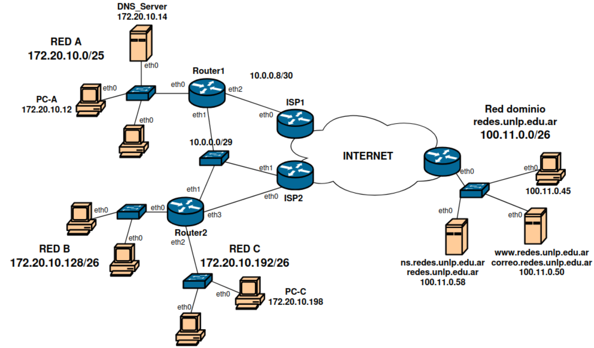

# Capa de enlace

## ARP (Address Resolution Protocol)

---

# ¿Qué hace la capa de enlace?

- Entramado (framing):
    - encapsulado del datagrama en la trama (PDU), agregando encabezado (*header*) y cola (*trailer*)
- Acceso al enlace:
    - acceso al canal si es un medio compartido (*Medium Access Control*)
    - direcciones MAC utilizadas en los encabezados de las tramas para identificar el origen y destino
- Entrega confiable:
    - entre nodos adyacentes
    - rara vez se usa en enlaces de pocos errores (fibra óptica, pares enlazados, etc.)
- Control de flujo
    - acuerdo entre los nodos emisor y receptor (aquí, adyacentes)
    - buffers y capacidad de procesamiento

---

# ¿Qué hace la capa de enlace?

- Detección de errores
    - errores causados por atenuación de la señal, por ruido, etc.
    - el receptor detecta presencia de errores
        - señaliza al emisor para una retransmisión o descarta la trama
- Corrección de errores (FEC)
    - el receptor identifica y corrige el o los erroes en bit/s sin necesidad de retransmisión
- half-duplex y full-duplex:
    - con half-duplex, los nodos en los extremos del enlace pueden transmitir pero no al mismo tiempo


```text
Paquete IP  →  encapsulado en una trama Ethernet  →  enviado por el enlace
```


---

# Direcciones MAC

Una MAC Ethernet tiene **48 bits** y suele escribirse como seis pares hexadecimales.

```text
02:1A:2B:3C:4D:5E
```

- **Broadcast Ethernet:** `FF:FF:FF:FF:FF:FF`, destino a todas las interfaces de la LAN.

```bash
❯ ip link show docker0
4: docker0: <NO-CARRIER,BROADCAST,MULTICAST,UP> mtu 1500 qdisc noqueue state DOWN mode DEFAULT group default qlen 0
    link/ether 3a:91:c4:2d:7f:b8 brd ff:ff:ff:ff:ff:ff
```

```bash
❯ ip -br link
lo               UNKNOWN        00:00:00:00:00:00 <LOOPBACK,UP,LOWER_UP> 
enp0s31f6        DOWN           b2:6c:83:14:a7:50 <NO-CARRIER,BROADCAST,MULTICAST,UP> 
wlan0            UP             5e:2f:91:c8:43:ab <BROADCAST,MULTICAST,UP,LOWER_UP> 
docker0          DOWN           3a:91:c4:2d:7f:b8 <NO-CARRIER,BROADCAST,MULTICAST,UP> 
```


--- 

# ARP

¿Qué es?

- protocolo de capa 2 (a veces considerado de capa 3)
- protocolo "*helper*" de IP
- mapea direcciones lógicas (IPs) a direcciones físicas o de hardware (MACs)
- trabaja conjuntamente con Ethernet (u otros protocolos multiacceso con broadcast)
- trabaja de forma dinámica, autoaprendizaje, sin configuración
- puede configurarse de forma estática
- RFC-826


---

# Cómo viaja ARP en Ethernet

```text
TRAMA ETHERNET II
┌────────────── Cabecera Ethernet II (14 bytes) ───────────────┐┌── Mensaje ARP (28 bytes) ───┐
│ MAC destino (6) │ MAC origen (6) │ EtherType (2)             ││ Campos ARP                  │
└──────────────────────────────────────────────────────────────┘└─────────────────────────────┘
```

| Campo Ethernet | Valor en el request |
| --- | --- |
| MAC destino | `FF:FF:FF:FF:FF:FF` (broadcast) |
| MAC origen | `02:00:00:00:00:0A` (PC A) |
| EtherType | `0x0806` (contenido ARP) |


---

# Veamos un ejemplo: las tablas ARP están vacías



- **PC-A** realiza una consulta DNS hacia **DNS_Server** y recibe una respuesta exitosa. Indique el ARP **Request** y ARP **Reply** que pasan por el switch de la Red A.

- **PC-C** realiza un ping ICMP hacia **PC-A**. Indique ARP **Request** y ARP **Reply** que pasan por el switch de la red Red C.


---

# El problema que resuelve ARP

La PC conoce la IP del destino, pero para armar una trama Ethernet necesita su MAC.

**ARP** (Address Resolution Protocol) pregunta qué dirección MAC corresponde a una dirección IPv4 dentro de la red local.

| **Dato** | **Valor en la topología** |
| --- | --- |
| Red A | `172.20.10.0/25` |
| IP de PC-A | `172.20.10.12` |
| IP de DNS_Server | `172.20.10.14` |
| MAC de PC-A / DNS_Server | `MAC_PC-A_eth0` |
| DNS_Server | `MAC_DNS_Server_eth0` |


---

## Caso 1: ARP Request de PC-A hacia DNS_Server

#### Paso 1: MAC destino Ethernet

<EncapsulationTable :stage="0" />

PC-A (`172.20.10.12`) consulta quién tiene la IP del DNS (`172.20.10.14`).

---

## ARP Request: completar la trama

#### Paso 2: MAC origen Ethernet

<EncapsulationTable :stage="1" />


---

## ARP Request: mensaje encapsulado

#### Paso 3: MAC origen ARP (`SHA`)

<EncapsulationTable :stage="2" />

`SHA` identifica al emisor del mensaje ARP.

---

## ARP Request: mensaje encapsulado

#### Paso 4: IP origen ARP (`SPA`)

<EncapsulationTable :stage="3" />


---

## ARP Request: mensaje encapsulado

#### Paso 5: MAC destino ARP (`THA`)

<EncapsulationTable :stage="4" />

Como PC-A aún no conoce la MAC del DNS_Server, `THA` se envía en cero.

---

## ARP Request: mensaje encapsulado

#### Paso 6: IP objetivo ARP (`TPA`)

<EncapsulationTable :stage="5" />


---

## ARP Request completo

<EncapsulationTable :stage="6" />

La IP buscada es la del DNS_Server: `172.20.10.14`.


---

# Dominios de broadcast y de colisión

En la topología, cada red local conectada a un router es un dominio de broadcast distinto: Red A (`172.20.10.0/25`), Red B (`172.20.10.128/26`) y Red C (`172.20.10.192/26`). El router no reenvía el broadcast ARP de una red a las otras.

- En Red A, el request de PC-A llega por el switch a DNS_Server y a las demás interfaces de esa LAN.
- En Red C, un request de PC-C para encontrar el gateway llega a los puertos del switch de Red C, no a Red A.
- En un switch, cada puerto constituye su propio dominio de colisión; con enlaces full-duplex no se producen colisiones.
- Los routers separan dominios de broadcast; los switches los extienden dentro de la misma LAN/VLAN.


---

# 1. ARP Request de PC-A a DNS_Server

PC-A (`172.20.10.12`) pregunta quién tiene la IP del DNS_Server (`172.20.10.14`). Ambos están en Red A (`172.20.10.0/25`), así que la consulta se resuelve en esa LAN. En la cabecera Ethernet, la **MAC destino es broadcast**; dentro de ARP, `TPA` contiene la IP buscada.

| Campo ARP | Valor del request |
| --- | --- |
| `HTYPE` | `0x0001` (Ethernet) |
| `PTYPE` | `0x0800` (IPv4) |
| `HLEN` | `6` (bytes por MAC) |
| `PLEN` | `4` (bytes por IPv4) |
| `OPER` | `0x0001` (request) |
| MAC origen (`SHA`) | `MAC_PC-A_eth0` (no indicada en la imagen) |
| IP origen (`SPA`) | `172.20.10.12` (PC-A) |
| MAC destino (`THA`) | `00:00:00:00:00:00` (desconocida) |
| IP destino (`TPA`) | `172.20.10.14` (DNS_Server) |

**Clave:** `FF:FF:FF:FF:FF:FF` es la MAC destino Ethernet (broadcast); `THA` queda en cero porque PC-A aún no conoce la MAC del servidor. ARP incluye las IP de origen y objetivo en `SPA` y `TPA`; no va encapsulado dentro de un paquete IP. **Pregunta:** «¿Quién tiene `172.20.10.14`? Responde a `172.20.10.12`».


---

# ¿Qué ocurre con el request?

<div v-click>

1. El switch recibe la trama y aprende qué MAC está detrás del puerto de PC A.

</div>
<div v-click>

2. Como la MAC destino es broadcast, el switch la distribuye por los puertos de esa LAN/VLAN, excepto el de entrada.

</div>
<div v-click>

3. Los equipos reciben la solicitud; DNS_Server (`172.20.10.14`) es quien debe responder.

</div>

El request no atraviesa un router: ARP resuelve direcciones en el enlace local.


---

# 2. ARP Reply de DNS_Server a PC-A

DNS_Server reconoce su IP y responde a PC-A. Las MAC exactas no aparecen en la topología, así que se representan con nombres simbólicos.

#### Paso 1: MAC destino Ethernet

<EncapsulationTable mode="reply" :stage="0" />


---

## ARP Reply: completar la trama

#### Paso 2: MAC origen Ethernet

<EncapsulationTable mode="reply" :stage="1" />


---

## ARP Reply: mensaje encapsulado

#### Paso 3: MAC origen ARP (`SHA`)

<EncapsulationTable mode="reply" :stage="2" />


---

## ARP Reply: mensaje encapsulado

#### Paso 4: IP origen ARP (`SPA`)

<EncapsulationTable mode="reply" :stage="3" />


---

## ARP Reply: mensaje encapsulado

#### Paso 5: MAC destino ARP (`THA`)

<EncapsulationTable mode="reply" :stage="4" />


---

## ARP Reply: mensaje encapsulado

#### Paso 6: IP destino ARP (`TPA`)

<EncapsulationTable mode="reply" :stage="5" />


---

## ARP Reply completo

<EncapsulationTable mode="reply" :stage="6" />

En un ARP Reply, el equipo que posee la IP consultada informa su MAC al emisor, normalmente mediante un mensaje unicast.


---

# Después del reply

<div v-click>

1. PC-A guarda temporalmente la relación `172.20.10.14 → MAC_DNS_eth0` en su caché ARP.

</div>
<div v-click>

2. PC-A envía el paquete IP al DNS_Server dentro de una trama con `MAC_DNS_eth0` como destino.

</div>
<div v-click>

3. Para otros paquetes a esa IP, PC A reutiliza la caché mientras la entrada siga vigente.

</div>

```text
PC-A ── request broadcast ──> Red A
PC-A <── reply unicast ───── DNS_Server
PC-A ── trama a MAC del DNS ─> DNS_Server
```


---

# ¿Y si el destino está en otra red?

PC-A compara la IP destino con su propia subred. En el esquema, PC-A (`172.20.10.12`) está en Red A y PC-C (`172.20.10.198`) en Red C.

- **Destino en la misma subred:** resuelve por ARP la MAC del equipo destino.
- **Destino en otra subred:** PC-C no busca por ARP la MAC de PC-A; busca la MAC del gateway conectado a Red C, Router2 `eth2`.

La trama Ethernet llega a Router2; el paquete IP conserva como destino `172.20.10.12` (PC-A). El router crea otra trama para el siguiente enlace. La IP/MAC de Router2 `eth2` y la MAC de PC-C no están especificadas en la imagen.

**ARP no busca la MAC de un equipo remoto a través de Internet.**


---

# Resumen

- Las direcciones IP identifican destinos lógicos; las MAC entregan tramas en el enlace local.
- ARP asocia una IPv4 local con una dirección MAC.
- **Request:** PC-A busca por broadcast a `172.20.10.14` en Red A; PC-C busca por broadcast la MAC de su gateway en Red C.
- **Reply:** DNS_Server o Router2 responde con su MAC en un mensaje normalmente unicast.
- La relación se guarda en caché; para destinos remotos, se resuelve la MAC del gateway, no la del host remoto.


